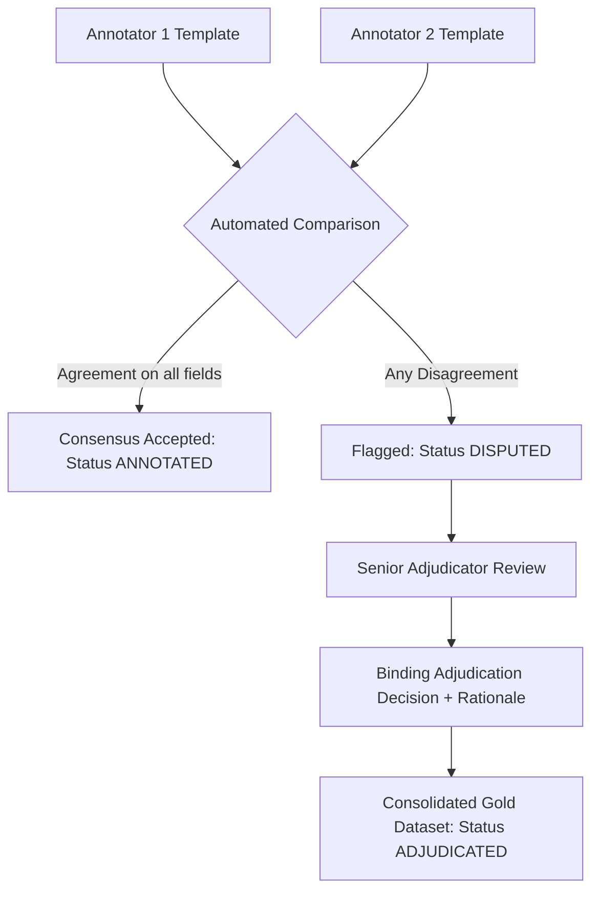

# Phase 8 — Human Annotation Guidelines & Operational Manual
**NIFTY AI — Next-Trading-Day Return Forecasting Engine**  
**Phase:** Phase 8 — News & NLP Intelligence Layer  
**Role:** Human Annotation Operational Standard  
**Date:** 2026-09-16  
**Document Version:** 1.2.0  
**Target Corpus:** Authentic Historical NSE Corporate Disclosures (2008–2021)  

---

## 1. Introduction & Purpose

### 1.1 Operational Annotation Architecture (Version 1.2.0 AI-Assisted Update)
Under the approved Version 1.2.0 operational framework, Phase 8 employs an **AI-Assisted Annotation Methodology**:
- **Annotator 1 (Human Reference Annotation)**: Project owner (human domain expert) provides authoritative ground-truth annotations.
- **Annotator 2 (Independent Blind AI Pass)**: Independent AI evaluation pass operating on identical raw input templates without access to Annotator 1 labels.
- **Validation**: Evaluated via Human-vs-AI agreement / sensitivity analysis. This metric measures AI-human concordance and must **never** be cited as human-human inter-annotator reliability.
- **Adjudication**: Human adjudication procedure is defined in the methodology but has not been executed as a separate adjudication pass.
- **Formal Limitation**: *Annotator 2 is an independent AI annotation pass. It is not a human expert and therefore cannot establish human inter-annotator reliability. The resulting agreement metrics are used for sensitivity/QC validation only.*

This operational manual establishes the standardized protocol for independent human annotators evaluating authentic corporate disclosures from the National Stock Exchange of India (NSE). 

The NIFTY AI forecasting engine predicts next-trading-day directional movements and returns for the NIFTY 50 index under strict point-in-time (PIT) information constraints. The purpose of this annotation effort is to establish an **objective, scientifically defensible empirical ground truth** for:
1. **Sentiment Polarity** (directional economic impact on the affected company)
2. **Event Classification** (17 substantive canonical primary-event categories plus 1 fallback category (OTHER), yielding 18 total primary-event categories)
3. **NIFTY Market Relevance** (ex-ante index price transmission)
4. **Economic Importance** (1–5 ordinal impact scale)

---

## 2. Fundamental Annotation Principles

### A. Economic vs. Emotional Sentiment
> [!IMPORTANT]
> Annotations must reflect **financial valuation and cash-flow implications**, NOT general literary, emotional, or journalistic sentiment. 
> 
> A disclosure reading *"Company regrets to inform the passing of Non-Executive Independent Director"* is emotionally sad, but economically **NEUTRAL** unless the individual was the irreplaceable founder/CEO. 
> 
> Similarly, a disclosure reading *"Company successfully repays Rs. 500 Crore debentures on maturity"* may sound proud, but debt repayment on schedule is an expected contractual obligation and therefore economically **NEUTRAL** (or mildly positive only if the firm was in financial distress).

### B. Strictly Ex-Ante (Zero Hindsight)
Annotators must evaluate each disclosure using **ONLY** the information contained in the document text at the specified publication timestamp.
- **NEVER** check subsequent stock price movement.
- **NEVER** check whether the NIFTY index went up or down the next day.
- **NEVER** look up later disclosures or articles published after the cutoff.
- **NEVER** infer sentiment from hindsight outcomes (e.g., if an acquisition announced in 2010 later failed in 2015, annotate the 2010 announcement strictly based on what was known in 2010).

### C. Double-Blind Independence
- Annotators work completely independently.
- Do not discuss records, share spreadsheets, or compare labels prior to formal dispute adjudication.
- If you are uncertain about a record, assign your best judgment, select `Confidence: LOW`, and provide a detailed explanation in the `notes` field.

---

## 3. Labeling Taxonomy & Rubrics

### Component A: Sentiment Polarity
Annotators must assign exactly **one** sentiment label:

| Label | Economic Definition | Concrete Filing Examples |
| :--- | :--- | :--- |
| **`POSITIVE`** | The disclosed development is reasonably expected to increase future equity cash flows, improve operating margins, strengthen competitive position, reduce solvency risk, or upgrade creditworthiness. | - Net profit / EBITDA exceeds expectations with margin expansion. - Major new commercial order win ($>10\%$ of annual revenue). - Credit rating upgrade by CRISIL / ICRA / CARE. - Launch of successful new high-margin product / commissioning of plant ahead of schedule. - Favorable tax dispute settlement or court dismissal of injunction. |
| **`NEGATIVE`** | The disclosed development is reasonably expected to impair earnings, erode operating margins, elevate legal/regulatory liabilities, dilute equity holders, or increase insolvency risk. | - Sharp decline in quarterly profit or unexpected EBITDA loss. - Regulatory penalty, search/seizure by ED/CBI/Income Tax, or SEBI show-cause notice. - Credit rating downgrade or assignment of negative outlook. - Sudden resignation of Auditor, Managing Director, or CFO amidst governance disputes. - Cancellation of major customer contract or plant shutdown due to strike/fire. |
| **`NEUTRAL`** | Routine compliance filings, procedural secretarial updates, scheduled business notices, or balanced disclosures where positive and negative factors offset. | - Procedural notice of board meeting date / AGM schedule. - Intimation of trading window closure pursuant to SEBI (PIT) Regulations. - Loss of share certificates / issuance of duplicate share certificates. - Routine approval of ordinary business items at AGM. - Credit rating reaffirmed at existing level. |
| **`UNCERTAIN`** | The disclosure is highly ambiguous, contradictory, or structurally impossible to evaluate directionally without non-public technical data. | - Complex corporate demerger or scheme of arrangement where restructuring ratios are unspecified. - Notice of dispute without disclosure of financial claim magnitude. - Highly conditional MoU with non-binding terms. |

---

### Component B: Primary Event Classification (17 Substantive + 1 Fallback = 18 Total Categories)
Annotators select exactly **one primary event class** representing the core operational substance of the filing, choosing from **17 substantive canonical primary-event categories plus 1 fallback category (`OTHER`), yielding 18 total primary-event categories**:

1. **`EARNINGS_RESULTS`**: Quarterly or annual audited/unaudited financial statements, revenue/profit prints, EBITDA margin disclosures, segmental financial performance, earnings beats or misses.
2. **`DIVIDEND`**: Dividend recommendations, declarations, interim/final dividend payouts, special dividends, dividend payment schedules, or book closure dates for dividends. *(Note: If an announcement is solely a dividend recommendation without accompanying financial results, it must be classified as `DIVIDEND` under Rule 1).*
3. **`BONUS_SPLIT`**: Bonus share issues, stock splits, sub-division of nominal share value, consolidation of shares, and capital structure ratio alterations.
4. **`RIGHTS_ISSUE`**: Rights entitlement offerings, letters of offer, rights issue pricing, entitlement ratios, and rights issue record dates.
5. **`BUYBACK`**: Share buyback proposals, approvals by board/shareholders, tender offers, open-market buyback purchases, extinguishment of equity shares, and buyback completion/closure.
6. **`M_AND_A`**: Mergers, acquisitions, demergers, spin-offs, amalgamations, business takeovers, slump sales, transfer of business undertakings, and schemes of arrangement.
7. **`CAPEX_BUSINESS_UPDATE`**: Capital expenditures, commissioning of new manufacturing plants/facilities, brownfield/greenfield capacity expansions, operational milestones, commercial launch of new business divisions.
8. **`FINANCIAL_IRREGULARITY`**: Audit qualifications, auditor resignations citing disagreements, forensic audits, accounting fraud disclosures, financial restatements, or default declarations.
9. **`SHAREHOLDING_CHANGE`**: Promoter share pledging or revocation, insider trading disclosures under PIT regulations, substantial acquisition of shares and takeovers (SAST) filings, creeping acquisitions by promoters.
10. **`OPERATIONAL_EVENT`**: Strikes, lockouts, labor disputes, temporary factory shutdowns, industrial accidents, fires, supply chain breakdowns, or non-regulatory operational disruptions.
11. **`STRATEGIC_PARTNERSHIP`**: Joint ventures, non-equity commercial alliances, technical collaborations, technology transfer pacts, co-development agreements.
12. **`CREDIT_RATING_DEBT`**: Credit rating upgrades, downgrades, outlook revisions, or reaffirmations by rating agencies (CRISIL, ICRA, CARE); bond/commercial paper issuances; scheduled debenture redemptions; debt restructuring.
13. **`FUNDRAISING`**: Qualified Institutional Placements (QIP), preferential allotments to strategic/financial investors, American/Global Depository Receipts (ADR/GDR), and external equity capital raises (excluding micro ESOP allotments).
14. **`REGULATORY_LEGAL`**: Regulatory actions, orders, show-cause notices, search/seizure actions by statutory bodies (SEBI, RBI, CCI, ED, CBI, USFDA drug approvals or Form 483 inspection observations, environmental tribunal rulings, high court/Supreme Court litigation, tax penalties).
15. **`CORPORATE_ACTION`**: Routine corporate actions, loss of share certificates, issuance of duplicate share certificates, secretarial compliance certificates (Reg 7(3)/40(9)), intimation of trading window closure, routine ESOP/ESOS allotments (<0.1% dilution).
16. **`MANAGEMENT_CHANGE`**: Appointment, re-appointment, retirement, resignation, cessation, or demise of Directors, Managing Director, CEO, CFO, Company Secretary, Statutory Auditors, or Key Managerial Personnel (KMP).
17. **`ORDER_CONTRACT`**: Major commercial order wins, client contracts, government supply agreements, defense tenders, infrastructure project awards, or major export deals.
18. **`OTHER`**: Purely residual fallback for administrative notices or secretarial intimations that cannot logically map to any of the 17 substantive categories (e.g., change of registered office address, registrar contact details update).

---

### Component C: Secondary Event Multi-Labels
Where a disclosure contains multiple concurrent material announcements, annotators may select **up to 3 secondary event classes** from the same 18-category taxonomy (or `NONE` if no secondary event applies).
- *Example 1*: A board meeting outcome announcing quarterly financial results AND recommending a dividend:
  - **Primary Event**: `EARNINGS_RESULTS`
  - **Secondary Events**: `DIVIDEND`
- *Example 2*: A company announces a major new plant expansion financed through a debenture issue:
  - **Primary Event**: `CAPEX_BUSINESS_UPDATE`
  - **Secondary Events**: `CREDIT_RATING_DEBT`
- If no secondary event applies, record `NONE` (or leave empty).

---

### Component D: NIFTY 50 Market Relevance
Evaluates the ex-ante potential for this announcement to transmit into price formation for the aggregate **NIFTY 50 index**:

| Relevance | Criteria & Index Transmission Mechanism |
| :--- | :--- |
| **`HIGH`** | Direct corporate catalyst for a top NIFTY 50 index heavyweight (e.g., Reliance, HDFC Bank, Infosys, ICICI Bank, TCS) OR a systemic sector-wide announcement impacting multiple index constituents. |
| **`MEDIUM`** | Significant corporate announcement for a mid-weight NIFTY constituent (e.g., Tata Steel, Hindalco, Cipla, Sun Pharma, Bajaj Auto) OR an announcement with clear sector spillover. |
| **`LOW`** | Standard company-specific operational disclosure for a smaller index constituent with negligible direct index-weight transmission. |
| **`NONE`** | Pure compliance or secretarial filing (e.g., loss of share certificates, duplicate shares, procedural certificate under Reg 7(3)) with zero pricing transmission to the NIFTY index. |

---

### Component E: Economic Importance Score (1–5 Ordinal Scale)
Quantifies the intrinsic magnitude of the disclosure, independent of directionality:

| Score | Level | Concrete Benchmark Rubric | Typical Disclosures |
| :---: | :--- | :--- | :--- |
| **1** | **Negligible** | Pure secretarial/statutory compliance with zero operational impact. | Loss of share certificates, issue of duplicate share certificate, secretarial audit compliance certificates (Reg 40(9)), intimation of closure of trading window. |
| **2** | **Low** | Routine operational notices or scheduled corporate events. | Advance intimation of board meeting date, dispatch of annual report, routine analyst meet schedule, postal ballot notice without contentious agenda. |
| **3** | **Moderate** | Standard corporate actions or operational updates. | Outcome of AGM approving ordinary business, commercial contract ($<5\%$ of annual revenue), routine credit rating reaffirmation, appointment of non-executive independent director. |
| **4** | **High** | Material financial, managerial, or commercial catalysts. | Quarterly earnings report with significant beat/miss, major M&A deal, unexpected CEO/CFO resignation, contract win ($>15\%$ of annual revenue), credit rating upgrade/downgrade. |
| **5** | **Very High** | Transformational, catastrophic, or systemic corporate events. | Unexpected corporate fraud disclosure (e.g., Satyam 2009), regulatory ban by SEBI/RBI on core lending/operating licenses, massive debt default, hostile takeover, nationwide operational shutdown. |

---

### Component F: Annotator Confidence
- **`HIGH`**: Unambiguous text, standard filing structure, clear financial implications.
- **`MEDIUM`**: Minor ambiguity in wording, complex multi-part disclosure, or moderate uncertainty regarding materiality.
- **`LOW`**: Highly opaque filing, legalistic jargon obscuring key facts, or conflicting signals within the same announcement.

---

## 4. Prohibited Information & Disqualification

Annotators found violating any of the following rules will have their annotations disqualified:
1. **NO FUTURE PRICE LOOKUP**: Under no circumstances may an annotator consult stock charts, Bloomberg terminals, Yahoo Finance, or Google to observe how the stock or NIFTY reacted after the announcement.
2. **NO MODEL OUTPUTS**: Annotators must never view, request, or consult predictions, probabilities, or embeddings generated by any NLP model, rule, or LLM.
3. **NO LIVE WEB CONTENT**: When inspecting source URLs, annotators must evaluate ONLY the text present in the snapshot file. Live web pages may contain subsequent updates, revisions, or price tickers.
4. **NO COLLUSION**: Annotator 1 and Annotator 2 must not discuss records before both have submitted their independent templates.

---

## 5. Adjudication & Dispute Resolution Workflow

1. **Automated Disagreement Flagging**:
   - `sentiment_disagreement`: `Annotator 1 Sentiment != Annotator 2 Sentiment`
   - `event_disagreement`: `Annotator 1 Primary Event != Annotator 2 Primary Event`
   - `importance_disagreement`: `|Annotator 1 Importance - Annotator 2 Importance| >= 2`
2. **Adjudication Process**:
   - The Senior Adjudicator reviews the original filing text and both annotator rationales.
   - The Senior Adjudicator records a binding decision (`final_gold_*`) and enters a mandatory explanation ($\ge 10$ words) in `adjudication_rationale`.
   - Raw independent annotations are **permanently preserved** and never modified.

---

## 6. Special Clarification & Post-Audit Targeted Guideline Refinements

Following the Phase 8 Human Pilot Calibration Audit and the AI-simulated Annotator 2 Disagreement Audit, annotators must adhere strictly to the following four targeted operational rules:

### Rule 1: Multi-Event Precedence Hierarchy
When an authentic corporate disclosure bundles multiple concurrent corporate events into a single announcement (e.g. a board meeting outcome considering quarterly results, declaring dividends, and approving capital actions), assign `primary_event` according to the following strict waterfall:

$$\text{EARNINGS\_RESULTS} > \text{DIVIDEND} > \text{M\_AND\_A} > \text{MANAGEMENT\_CHANGE} > \text{CORPORATE\_ACTION} > \text{OTHER}$$

- **Strict Exception**: If the disclosure is solely a dividend recommendation or announcement without accompanying financial results or financial figures (e.g. an interim/final dividend notice or book closure for dividend), classify it strictly as **`DIVIDEND`**, NOT `EARNINGS_RESULTS`.
- **Secondary Event Capture**: Secondary events must be used to capture concurrent material events where supported by the annotation schema (e.g., Primary = `EARNINGS_RESULTS`, Secondary = `DIVIDEND`).

### Rule 2: ESOP Allotments vs. External Capital Fundraising
- **Routine Micro-Allotments (< 0.1% Dilution)**: Allotments of shares under Employee Stock Option Plans (ESOPs) representing less than 0.1% of existing paid-up capital must be classified as:
  - `primary_event = CORPORATE_ACTION`
  - `importance = 1` or `2`
  - `sentiment = NEUTRAL` (unless explicit, economically material information indicates otherwise).
- **Reservation of `FUNDRAISING`**: The `FUNDRAISING` event category is reserved strictly for material external capital infusions such as Qualified Institutional Placements (QIPs), rights issues, global depository receipts (GDRs/ADRs), or material preferential allotments to promoters/private equity investors.
- **Denominator Safeguard**: Do **NOT** blindly apply the 0.1% threshold when the required denominator (total paid-up capital) is unavailable in the filing text. In such cases, evaluate textual economic materiality evidence, assign conservative importance (`2`), and flag confidence as `MEDIUM` or `LOW`.

### Rule 3: Management Change vs. Board Meeting Mention
- **Substantive Event Isolation**: Announcements of director appointments, resignations, cessations, or demises must **NOT** be classified as `EARNINGS_RESULTS` merely because the filing references a meeting of the Board of Directors.
- Use **`MANAGEMENT_CHANGE`** whenever management personnel or board composition change is the substantive operational event of the disclosure.
- **Emotional vs. Financial Framing**: Reiterate that notices of director demise represent personal loss but carry negligible ex-ante price transmission for large-cap constituents; code as **`NEUTRAL`**, `importance = 2`, `relevance = LOW`, and event category **`MANAGEMENT_CHANGE`**.

### Rule 4: Strict Boundaries on the `OTHER` Event Category
- **Residual Mapping Only**: `OTHER` must be used **ONLY** when the filing cannot logically map to any of the 17 substantive canonical primary-event categories.
- **Substance-First Evaluation for Press Releases**: Routine press release intimations or exchange cover letters must be examined for actual economic substance before assigning `OTHER`. Annotators must inspect the underlying corporate action:
  - Major commercial contracts or customer wins $\rightarrow$ **`ORDER_CONTRACT`**
  - Plant commissioning, capacity expansion, or physical investments $\rightarrow$ **`CAPEX_BUSINESS_UPDATE`**
  - Strikes, factory disruptions, or regulatory inspections $\rightarrow$ **`OPERATIONAL_EVENT`**
  - Show-cause notices, tax demand appeals, or court orders $\rightarrow$ **`REGULATORY_LEGAL`**
  - Share capital alteration, record date, or book closure $\rightarrow$ **`CORPORATE_ACTION`**
- Only purely procedural secretarial notifications with zero operational substance (e.g. change of company secretary address, registry update) may be assigned `OTHER`.

### Supplementary Clarifications
1. **Routine Debt Servicing & Final Bond Redemption**:
   - Do NOT classify filings as `NEGATIVE` merely because terms such as *"suspension"*, *"redemption"*, or *"closure"* appear in exchange notices.
   - When trading in a specific bond, debenture, or preference share series is suspended *"on account of final redemption"* at scheduled maturity, this represents planned retirement of debt. Classify as **`NEUTRAL`**, `importance = 2`, and event **`CORPORATE_ACTION`** (or `CREDIT_RATING_DEBT`).
2. **Preference-Share Dividends**:
   - Evaluate preference share dividends in their proper face-value/unit context (e.g. 7% pro-rata on Re. 1/- RPS); classify as **`POSITIVE`** or **`NEUTRAL`**, never `NEGATIVE`.
3. **Subsidiary Incorporation**:
   - Routine formation of a wholly owned subsidiary is standard business expansion; cap at **`importance = 3`**, not `5`.
