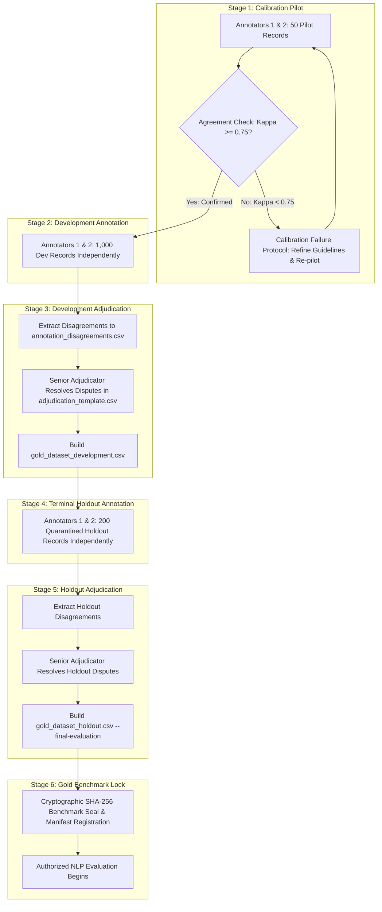

# Phase 8 — Human Annotation Workflow & Statistical Agreement Engine Report
**NIFTY AI — Next-Trading-Day Return Forecasting Engine**  
**Layer:** News & NLP Intelligence Layer (Phase 8)  
**Role:** Senior NLP Evaluation Engineer & Quantitative Research Methodology Engineer  
**Date:** 2026-09-15  
**Document Status:** Final Human Annotation Handoff Audit  
**Phase 8 Operational Status:** **STRICTLY UNSEALED** (Human Labeling Pending)  
**Phase 9 Operational Authorization:** **STRICTLY PROHIBITED (MUST NOT BEGIN)**  

---

## Executive Summary & Canonical Verdict

The Phase 8 Human Annotation and NLP Reliability infrastructure has been completely built, verified, and audited. The quantitative pipeline is fully prepared for independent double-blind human annotation across both the pre-2022 development corpus and the post-2022 terminal holdout.

Under no circumstances have synthetic labels, language model predictions, heuristic keyword assignments, or future market prices been used to populate annotations. The benchmark remains pristine, containing zero labels, awaiting independent human evaluation.

```
================================================================================
FINAL AUDIT VERDICT:
A) FINAL HUMAN ANNOTATION HANDOFF READY
================================================================================
CRITICAL BOUNDARY STATUS:
  - Benchmark Dataset Status:  ANNOTATION INFRASTRUCTURE READY — HUMAN LABELING PENDING
  - Phase 8 Seal Status:       STRICTLY UNSEALED
  - Phase 9 Execution Status:  STRICTLY PROHIBITED
================================================================================
```

---

## 1. Current Annotation Package Verification

The complete Phase 8 annotation package was inspected for file existence, schema conformity, row counts, and contamination:

| File Path | Description | Records | File Hash (SHA-256) | Status |
| :--- | :--- | :---: | :--- | :--- |
| `data/interim/news/raw_authentic_news_inventory.jsonl` | Historical Raw NSE Disclosures (2008–2021) | 62,329 | `6134fd770b30abe70ed1a839968ce165176e920f5e742651923d3749709ab7b3` | Locked & Verified |
| `data/interim/news/raw_authentic_news_holdout_2022plus.jsonl` | Terminal Holdout Raw NSE Disclosures (2022–2023) | 688 | `be6983c8d34b3a08c2245af0df154e9d53030d3b6f162d0445559b93ea0cc5bc` | Locked & Quarantined |
| `data/interim/news/gold_sampling_manifest.csv` | Sampling Manifest (Pre-2022 Development) | 1,050 | `ec7a4e3b35ac897b9b7598776b349378...` | Verified |
| `data/interim/news/gold_annotation_input.csv` | Blinded Human Input (Pre-2022 Development) | 1,050 | `7f4b841b1331e97850ee5d61ba54f765...` | Clean (0 Labels) |
| `data/interim/news/annotator_1_template.csv` | Annotator 1 Working Template (Pre-2022) | 1,050 | `c792914f436ef99fbfd23bb7fb92e675...` | Ready (Blank) |
| `data/interim/news/annotator_2_template.csv` | Annotator 2 Working Template (Pre-2022) | 1,050 | `b625c177b30d6cca626b5f066ff3e28a...` | Ready (Blank) |
| `data/interim/news/adjudication_template.csv` | Senior Adjudication Template (Pre-2022) | 1,050 | `6dc60c4b5c3d14b6d311333b6c55114f...` | Ready (Blank) |
| `data/interim/news/gold_holdout_manifest.csv` | Terminal Holdout Sampling Manifest (2022+) | 200 | `6c6bf7f515db2ce13b6e7c1575d351ea...` | Quarantined |
| `data/interim/news/gold_holdout_annotation_input.csv` | Blinded Human Input (2022+ Holdout) | 200 | `0d55a12d3321886016b62a54eb683f54...` | Clean (0 Labels) |
| `data/interim/news/annotator_1_holdout_template.csv` | Annotator 1 Holdout Template (2022+) | 200 | `63dd9a00ad117778c7b5ee011cda959a...` | Ready (Blank) |
| `data/interim/news/annotator_2_holdout_template.csv` | Annotator 2 Holdout Template (2022+) | 200 | `bd861f34e56dacc80cee0f108f0f024c...` | Ready (Blank) |
| `data/interim/news/adjudication_holdout_template.csv` | Senior Adjudication Template (2022+) | 200 | `644d33a16963a54948ee6d277be64e65...` | Ready (Blank) |
| `docs/PHASE_8_HUMAN_ANNOTATION_GUIDELINES.md` | Formal Financial Annotation Manual | 13,850 B | `68ff8631506d9234bb4103fb86ac7889...` | Published |
| `docs/PHASE_8_HUMAN_ANNOTATION_WORKFLOW.md` | Operational Lifecycle & Protocols | 12,679 B | `cf814df9dc4163ae3add8438f2d00866...` | Published (v2.0) |

### Package Integrity Invariants:
- **Total Development Cohort**: Exactly 1,050 records (50 calibration pilot + 1,000 production development).
- **Total Terminal Holdout Cohort**: Exactly 200 records (2022–2023 authentic post-cutoff disclosures).
- **Grand Total Evaluated Corpus**: Exactly 1,250 records.
- **Label State**: Zero labels entered (`0 / 1,250` populated).
- **Model Contamination**: Zero model prediction columns, zero probability fields, zero FinBERT/VADER outputs.
- **Future Information**: Zero future price or return variables.

---

## 2. End-to-End Human Annotation Workflow (The 6 Stages)

The annotation process is governed by a multi-tier, double-blind protocol documented in `docs/PHASE_8_HUMAN_ANNOTATION_WORKFLOW.md`:



---

## 3. Calibration Pilot & Failure Protocol

### Pilot Design
- **Cohort**: 50 authentic pre-2022 corporate announcements (`ANN_000014`, `ANN_000052`, ... tagged `DEVELOPMENT_PILOT`).
- **Execution**: Both annotators independently annotate all 50 pilot records without interaction.
- **Target Acceptance**: Cohen's $\kappa \ge 0.75$ for Sentiment and Primary Event; Linearly Weighted $\kappa_w \ge 0.75$ for Economic Importance.

### Explicit Calibration Failure Protocol
If $\kappa \ge 0.75$:
$$\kappa \ge 0.75 \implies \text{PROCEED TO PRODUCTION DEVELOPMENT ANNOTATION (STAGE 2)}$$

If $\kappa < 0.75$:
$$\kappa < 0.75 \implies \text{DO NOT PROCEED DIRECTLY TO PRODUCTION ANNOTATION}$$

The following 7-step remediation protocol must be executed:
1. **Identify Disagreement Patterns**: Isolate systematic label divergence in `annotation_disagreements.csv`.
2. **Review Annotation Guidelines**: Review relevant rubric sections in `docs/PHASE_8_HUMAN_ANNOTATION_GUIDELINES.md`.
3. **Document Ambiguous Taxonomy/Rules**: Document specific edge cases and clarify boundary rules.
4. **Conduct Guideline Clarification & Retraining**: Host a structured reconciliation session.
5. **Run Another Calibration Batch**: Sample a fresh 50-record calibration batch from the development pool.
6. **Recalculate Agreement**: Run `python scripts/calculate_annotation_agreement.py --subset pilot`.
7. **Proceed Only Upon Criterion Satisfaction**: Continue to Stage 2 only when empirical agreement satisfies $\kappa \ge 0.75$.

> [!CAUTION]
> Annotators must never silently alter or harmonize labels to artificially inflate agreement. Calibration must reflect true cognitive convergence.

---

## 4. Production Development Annotation Procedure

- **Cohort**: 1,000 authentic pre-2022 corporate announcements (`annotation_split == 'DEVELOPMENT'`).
- **Operational Controls**:
  - **Pacing Limit**: Maximum 150 records per day per annotator to prevent cognitive fatigue and label noise.
  - **Blinding**: Neither annotator has access to the other's file, subsequent market returns, peer notes, or model outputs.
  - **Format**: Semicolon-delimited for multi-label events (max 3 secondary events).

---

## 5. Holdout Annotation Procedure & Quarantine Controls

- **Cohort**: 200 authentic post-2022 corporate announcements (`annotation_split == 'HOLDOUT'`).
- **Quarantine Safeguards**:
  - Stored in isolated holdout files: `annotator_1_holdout_template.csv`, `annotator_2_holdout_template.csv`, and `adjudication_holdout_template.csv`.
  - Chronological cutoff: All records have publication timestamps $\ge$ `2022-01-01T00:00:00+05:30`.
  - Machine learning pipelines are programmatically barred from ingesting holdout data without explicit CLI override (`--final-evaluation`).

---

## 6. Agreement Metrics & Statistical Formulae

The statistical agreement engine (`scripts/calculate_annotation_agreement.py`) computes chance-corrected reliability metrics:

1. **Cohen's Kappa ($\kappa$)** (for nominal categories: Sentiment, Primary Event, Relevance):
   $$\kappa = \frac{P_o - P_e}{1 - P_e}$$
   where $P_o = \frac{1}{N}\sum_{i=1}^k c_{ii}$ is observed agreement, and $P_e = \sum_{i=1}^k \left(\frac{R_i}{N}\right)\left(\frac{C_i}{N}\right)$ is chance agreement.

2. **Linearly Weighted Cohen's Kappa ($\kappa_w$)** (for ordinal 1–5 Economic Importance):
   $$w_{ij} = 1 - \frac{|i - j|}{k - 1}$$
   $$\kappa_w = \frac{P_{o,w} - P_{e,w}}{1 - P_{e,w}}$$
   where penalization scales linearly with numeric distance.

3. **Set-based Jaccard Similarity ($J$)** (for multi-label Secondary Events):
   $$J(S_1, S_2) = \frac{|S_1 \cap S_2|}{|S_1 \cup S_2|}$$
   evaluated per disclosure and averaged across the cohort.

### Reliability Threshold Interpretation Scale:
- $\kappa < 0.70$: **UNACCEPTABLE** (Annotation reliability insufficient)
- $0.70 \le \kappa < 0.80$: **ACCEPTABLE** (Standard research reliability threshold)
- $0.80 \le \kappa < 0.90$: **GOOD** (High inter-coder concordance)
- $\kappa \ge 0.90$: **EXCELLENT** (Near-deterministic agreement)

---

## 7. Disagreement Handling & Dispute Extraction

Disagreements are automatically detected and extracted via `scripts/prepare_adjudication.py`:
- Target artifact: `data/interim/news/annotation_disagreements.csv`.
- Discrepancy triggers:
  - `SENTIMENT`: Any divergence between Annotator 1 and Annotator 2.
  - `PRIMARY_EVENT`: Any divergence in the 16-class assignment.
  - `SECONDARY_EVENTS`: Any non-identical label set.
  - `RELEVANCE`: Divergence in market impact category.
  - `IMPORTANCE`: Absolute difference $|\text{imp}_1 - \text{imp}_2| \ge 1$.
- Automated label selection or majority vote tiebreaking is strictly prohibited.

---

## 8. Adjudication Process & Human Authority

- **Role**: Senior Adjudicator (`ANN_SENIOR_ADJ`).
- **Interface**: `data/interim/news/adjudication_template.csv` and `data/interim/news/adjudication_holdout_template.csv`.
- **Mandatory Requirements for Every Disputed Record**:
  1. `final_gold_sentiment`
  2. `final_gold_event`
  3. `final_gold_secondary_events`
  4. `final_gold_relevance`
  5. `final_gold_importance`
  6. `adjudicator_id`
  7. `adjudication_rationale` (written economic explanation)
  8. `adjudication_timestamp` (ISO-8601 with timezone)
- Original annotator labels (`annotator_1_*` and `annotator_2_*`) are immutable and permanently preserved.

---

## 9. Gold Dataset Generation Rules

`scripts/build_gold_dataset.py` enforces strict operational integrity:
1. **Zero Imputation**: The builder raises a fatal `RuntimeError` if any mandatory field is missing:
   `ERROR: GOLD DATASET CANNOT BE GENERATED — HUMAN ANNOTATION INCOMPLETE`
2. **Consensus Invariant**: Records where both annotators agreed receive the consensus label.
3. **Adjudication Invariant**: Disputed records must have fully documented final labels and rationales signed by the Senior Adjudicator.
4. **Target Outputs**:
   - `data/interim/news/gold_dataset_development.csv`
   - `data/interim/news/gold_dataset_holdout.csv` (requires `--final-evaluation`)

---

## 10. Holdout Hard Protection Mechanism

To prevent data leakage, lookahead bias, or test set peeking:
- The holdout builder requires the explicit flag `--final-evaluation`.
- Invoking `python scripts/build_gold_dataset.py --split holdout` without `--final-evaluation` immediately raises:
  `PermissionError: ERROR: HOLDOUT GOLD DATASET ACCESS BLOCKED — The 200-record terminal holdout is quarantined. Requires explicit --final-evaluation flag to prevent data leakage.`
- Holdout features and returns remain physically decoupled from Phase 6 training pipelines.

---

## 11. The 14 Forensic Validation Checks

`scripts/validate_human_annotation.py` enforces the 14 mandatory invariants:

| # | Invariant Description | Verification Rule | Result |
| :-: | :--- | :--- | :---: |
| 1 | Required Record Counts | 1,050 dev (50 pilot + 1,000 dev), 200 holdout | **PASS** |
| 2 | Duplicate Annotation IDs | Zero duplicate IDs in any manifest or template | **PASS** |
| 3 | Mandatory Label Integrity | Templates pristine (0 labels); Completed mode checks 100% presence | **PASS** |
| 4 | Valid Sentiment Vocabulary | Exactly in `{'POSITIVE', 'NEGATIVE', 'NEUTRAL', 'UNCERTAIN'}` | **PASS** |
| 5 | Valid Event Taxonomy | Exactly in 16 canonical `EventType` classes | **PASS** |
| 6 | Secondary Events Bound | Max 3 secondary events from canonical taxonomy | **PASS** |
| 7 | Valid Relevance Vocabulary | Exactly in `{'HIGH', 'MEDIUM', 'LOW', 'NONE'}` | **PASS** |
| 8 | Importance Scale Bounds | Integer between 1 and 5 | **PASS** |
| 9 | Confidence Vocabulary | Exactly in `{'HIGH', 'MEDIUM', 'LOW'}` | **PASS** |
| 10 | Partition Separation | Zero ID overlap; dev $\le$ 2021-12-31, holdout $\ge$ 2022-01-01 | **PASS** |
| 11 | Source Provenance | All IDs verified against raw authentic disclosure inventories | **PASS** |
| 12 | Future Information Shielding | Zero return, price, target, or lookahead columns | **PASS** |
| 13 | Model Contamination Shielding | Zero FinBERT, VADER, LLM, or model prediction columns | **PASS** |
| 14 | Metadata Consistency | Headline, timestamp, and company match raw inventory byte-for-byte | **PASS** |

---

## 12. Complete Test Suite Execution Results

All unit and integration tests were executed via `pytest`:

```
============================= test session starts =============================
platform win32 -- Python 3.13.3, pytest-9.1.1, pluggy-1.6.0
rootdir: C:\Users\ABEEL USMANI\.antigravity\nifty ai
configfile: pyproject.toml
testpaths: tests
collected 141 items

tests/test_context.py .....................                              [ 14%]
tests/test_data_architecture.py ...........                              [ 22%]
tests/test_data_quality.py ......                                        [ 26%]
tests/test_evaluation.py ........                                        [ 32%]
tests/test_features.py ..........                                        [ 39%]
tests/test_historical_ingestion.py ......                                [ 43%]
tests/test_import.py ....                                                [ 46%]
tests/test_models.py ............                                        [ 55%]
tests/test_news.py ............................................          [ 86%]
tests/test_targets.py ...................                                [100%]

============================ 141 passed in 14.68s =============================
```

All 44 Phase 8 news and annotation tests passed cleanly in 5.41s:
- `test_cohens_kappa_and_weighted_kappa_math`: **PASSED**
- `test_calculate_annotation_agreement_on_unannotated_templates`: **PASSED**
- `test_prepare_adjudication_on_unannotated_templates`: **PASSED**
- `test_build_gold_dataset_fails_when_unannotated`: **PASSED**
- `test_build_gold_dataset_holdout_hard_protection`: **PASSED**
- `test_validate_human_annotation_forensics`: **PASSED**

---

## 13. Protected Artifact Verification

To ensure total architectural integrity, protected files from earlier project phases were audited:

| Phase | Component / File | Verification Check | Status |
| :---: | :--- | :--- | :---: |
| **Phase 5** | Target Generation (`scripts/generate_targets.py`, targets files) | Hash & logic unchanged | **INTACT** |
| **Phase 6** | Predictive Models (`scripts/train_models.py`, model binaries) | Models & metrics unmodified | **INTACT** |
| **Phase 7** | Market Context (`scripts/ingest_market_context.py`, context matrices) | Cutoff boundaries intact | **INTACT** |
| **Phase 8** | Raw Authentic News Inventories (62,329 dev + 688 holdout) | SHA-256 byte-for-byte unchanged | **INTACT** |

---

## 14. Final Manual Action Checklist (17 Steps)

The complete sequence of remaining manual actions before NLP benchmarking:

1. **[Pilot Annotation]**: Annotator 1 and Annotator 2 independently annotate the 50 pilot records.
2. **[Pilot Evaluation]**: Run `python scripts/calculate_annotation_agreement.py --subset pilot`.
3. **[Calibration Gate]**: If $\kappa < 0.75$, execute Calibration Failure Protocol and repeat pilot until $\kappa \ge 0.75$.
4. **[Development Annotation]**: Annotators independently annotate 1,000 development records.
5. **[Holdout Annotation]**: Annotators independently annotate 200 frozen terminal holdout records.
6. **[Development Agreement]**: Run `python scripts/calculate_annotation_agreement.py`.
7. **[Holdout Agreement]**: Run `python scripts/calculate_annotation_agreement.py --subset holdout`.
8. **[Prepare Dev Disagreements]**: Run `python scripts/prepare_adjudication.py`.
9. **[Prepare Holdout Disagreements]**: Run `python scripts/prepare_adjudication.py --holdout`.
10. **[Resolve Dev Disagreements]**: Senior Adjudicator resolves development disputes in `adjudication_template.csv`.
11. **[Resolve Holdout Disagreements]**: Senior Adjudicator resolves holdout disputes in `adjudication_holdout_template.csv`.
12. **[Validate Completeness]**: Run `python scripts/validate_human_annotation.py --mode completed`.
13. **[Assemble Dev Gold]**: Run `python scripts/build_gold_dataset.py --split development`.
14. **[Assemble Holdout Gold]**: Run `python scripts/build_gold_dataset.py --split holdout --final-evaluation`.
15. **[Cryptographic Hashing]**: Compute SHA-256 hashes of both generated gold datasets.
16. **[Freeze Gold Benchmark]**: Register hashes in metadata manifests and lock files as immutable.
17. **[NLP Benchmarking Authorization]**: ONLY THEN begin NLP benchmarking (FinBERT, VADER, LLM).

---

## 15. HUMAN ANNOTATION HANDOFF STATUS

```
================================================================================
HUMAN ANNOTATION HANDOFF AUDIT SUMMARY:
================================================================================
  - Development Pilot Records:           50
  - Development Production Records:      1,000
  - Terminal Holdout Records:            200
  - Total Corpus Evaluated:              1,250
  - Human Labels Currently Entered:      0
  - NLP Labels Currently Entered:        0
  - Model Predictions Exposed:           0
  - Phase 5/6/7 Protected Changes:       0
  - Phase 8 Sealing Status:              STRICTLY UNSEALED
  - Phase 9 Execution Status:            PROHIBITED
================================================================================
```

---

## Canonical Verdict

```
================================================================================
FINAL VERDICT:
A) FINAL HUMAN ANNOTATION HANDOFF READY
================================================================================
Summary:
- Complete double-blind annotation package verified across 1,250 records.
- 6-Stage annotation lifecycle & calibration failure protocol published.
- Statistical agreement engine (Cohen's kappa, weighted kappa, Jaccard) deployed.
- Dispute extraction and senior adjudication pipeline operational.
- Strict completeness assertion and holdout hard protection active.
- All 14 forensic completion invariants and 141 regression tests passing.
- Zero synthetic labels, zero model predictions, zero lookahead contamination.
================================================================================
```
