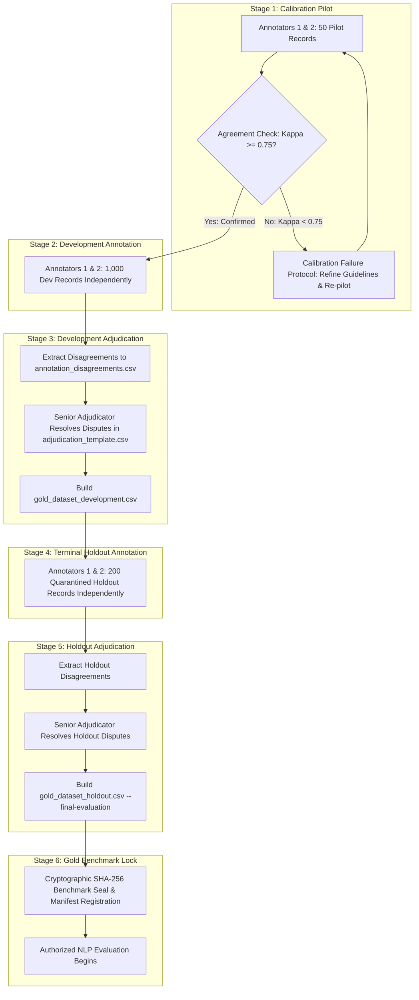

# Phase 8 — Human Annotation Operational Workflow & Adjudication Protocol
**NIFTY AI — Next-Trading-Day Return Forecasting Engine**  
**Phase:** Phase 8 — News & NLP Intelligence Layer  
**Role:** Human Annotation Protocol & Quality Assurance Standard  
**Date:** 2026-09-15  
**Document Version:** 2.0.0  
**Phase 8 Status:** **STRICTLY UNSEALED** (Human Annotation Stage)  
**Phase 9 Authorization:** **STRICTLY PROHIBITED (MUST NOT BEGIN)**  
**Benchmark State:** **ANNOTATION INFRASTRUCTURE READY — HUMAN LABELING PENDING (0 / 1,250 Labeled)**  

---

## 1. Overview & Operational Principles

This document specifies the operational lifecycle for conducting independent double-blind human annotation across the authentic NIFTY 50 corporate disclosure corpus (1,250 records).

### Strict Scientific Safeguards:
1. **Zero Artificial/Synthetic Generation**: Under no circumstances may labels be generated via LLMs, FinBERT, VADER, regex heuristics, keyword lookups, or market price outcomes.
2. **Double-Blind Independence**: Two primary financial annotators (`ANN_USER_1` and `ANN_USER_2`) work in complete isolation using decoupled template files.
3. **Point-in-Time Blinding**: Annotators see only the disclosure text and cutoff timestamp. Subsequent stock returns, NIFTY index moves, future news, and peer annotations are completely concealed.
4. **Adjudication Integrity**: Disputed records are resolved exclusively by a human Senior Adjudicator (`ANN_SENIOR_ADJ`). Original independent labels are permanently preserved.
5. **Holdout Hard Protection**: The 200-record terminal holdout is quarantined. Downstream access requires explicit authorization (`--final-evaluation`).

---

## 2. The 6-Stage Human Annotation Lifecycle



---

## 3. Detailed Stage Protocols

### Stage 1 — Calibration (50 Development-Pilot Records)
- **Cohort**: The first 50 records in `data/interim/news/gold_annotation_input.csv` tagged `DEVELOPMENT_PILOT` (`ANN_000014`, `ANN_000052`, ...).
- **Execution**:
  - Annotator 1 completes rows in `data/interim/news/annotator_1_template.csv`.
  - Annotator 2 completes rows in `data/interim/news/annotator_2_template.csv`.
- **Agreement Engine**:
  ```bash
  python scripts/calculate_annotation_agreement.py --subset pilot
  ```
- **Target Threshold**: Cohen's $\kappa \ge 0.75$ for Sentiment and Primary Event; Weighted $\kappa_w \ge 0.75$ for Importance.

---

### Stage 2 — Development Annotation (1,000 Production-Development Records)
- **Cohort**: 1,000 records in `data/interim/news/gold_annotation_input.csv` tagged `DEVELOPMENT`.
- **Execution**:
  - Both annotators independently annotate all 1,000 records without communication.
  - Pacing limit: Maximum 150 records per annotator per day to prevent cognitive fatigue.
  - All 6 required fields populated: `sentiment`, `sentiment_confidence`, `primary_event` (1 of 16), `secondary_events` (0–3), `relevance` (HIGH/MED/LOW/NONE), `importance` (1–5).

---

### Stage 3 — Development Adjudication
- **Disagreement Extraction**:
  ```bash
  python scripts/prepare_adjudication.py --input-1 data/interim/news/annotator_1_template.csv --input-2 data/interim/news/annotator_2_template.csv --template data/interim/news/adjudication_template.csv --disagreements data/interim/news/annotation_disagreements.csv
  ```
- **Senior Adjudicator Resolution**:
  - Senior Adjudicator (`ANN_SENIOR_ADJ`) reviews each disputed filing.
  - Auto-adjudication is **strictly forbidden**.
  - Must populate `final_gold_*`, `adjudicator_id`, `adjudication_rationale`, and `adjudication_timestamp`.
  - Original annotator labels remain immutable.
- **Dataset Assembly**:
  ```bash
  python scripts/build_gold_dataset.py --split development
  ```
  Produces `data/interim/news/gold_dataset_development.csv`. Fails loudly if human labeling or adjudication is incomplete.

---

### Stage 4 — Terminal Holdout Annotation (200 Frozen 2022–2023 Records)
- **Cohort**: 200 records in `data/interim/news/gold_holdout_annotation_input.csv` (`annotation_split == 'HOLDOUT'`).
- **Strict Freezing Guarantees**:
  - The holdout remains strictly frozen with respect to:
    - Model training
    - NLP hyperparameter tuning
    - Threshold selection
    - Feature selection
    - Model architecture selection
    - Event taxonomy modification
  - Human annotation is permitted solely to establish ground truth before any evaluation occurs.
- **Execution**:
  - Annotator 1 uses `data/interim/news/annotator_1_holdout_template.csv`.
  - Annotator 2 uses `data/interim/news/annotator_2_holdout_template.csv`.
  - Double-blind protocol identical to Stage 2.

---

### Stage 5 — Holdout Adjudication
- **Disagreement Extraction**:
  ```bash
  python scripts/prepare_adjudication.py --holdout
  ```
- **Adjudication**:
  - Senior Adjudicator resolves disputes in `data/interim/news/adjudication_holdout_template.csv`.
  - Preserves original annotator labels.
- **Holdout Assembly (Protected)**:
  ```bash
  python scripts/build_gold_dataset.py --split holdout --final-evaluation
  ```
  Produces `data/interim/news/gold_dataset_holdout.csv`.

---

### Stage 6 — Gold Benchmark Lock
- Compute cryptographic SHA-256 hashes for both datasets:
  - `gold_dataset_development.csv`
  - `gold_dataset_holdout.csv`
- Register hashes in `data/interim/news/gold_holdout_manifest_metadata.json`.
- Cryptographically lock and freeze both benchmark files.
- **ONLY AFTER THIS STEP MAY NLP BENCHMARKING (FinBERT, VADER, LLM) COMMENCE.**

---

## 4. Calibration Failure Protocol

If calibration pilot agreement satisfies $\kappa \ge 0.75$:
$$\kappa \ge 0.75 \implies \text{PROCEED TO PRODUCTION DEVELOPMENT ANNOTATION (STAGE 2)}$$

If calibration pilot agreement falls below 0.75 ($\kappa < 0.75$):
$$\kappa < 0.75 \implies \text{DO NOT PROCEED DIRECTLY TO PRODUCTION ANNOTATION}$$

The following mandatory remediation protocol must be executed:
1. **Identify Disagreement Patterns**: Analyze `annotation_disagreements.csv` to isolate systematic divergences (e.g., routine earnings press release vs management outlook; capital expenditure announcement vs generic corporate expansion).
2. **Review Annotation Guidelines**: Review relevant sections of `docs/PHASE_8_HUMAN_ANNOTATION_GUIDELINES.md` with both annotators.
3. **Document Ambiguous Taxonomy/Rules**: Document specific edge cases and clarify boundary rules.
4. **Conduct Guideline Clarification & Retraining**: Host a structured reconciliation and alignment session.
5. **Run Another Calibration Batch**: Sample a fresh 50-record calibration batch from the development pool.
6. **Recalculate Agreement**: Run `calculate_annotation_agreement.py` on the new pilot cohort.
7. **Proceed Only Upon Criterion Satisfaction**: Continue to Stage 2 only when empirical agreement satisfies $\kappa \ge 0.75$.

> [!CAUTION]
> Under no circumstances may annotators silently alter or homogenize labels after discussing them to artificially inflate $\kappa$. Calibration must reflect genuine, independent conceptual alignment.

---

## 5. Human Annotation Access Control & Blinding Protocol

To guarantee research validity without unnecessary authentication software:
- **Annotator 1 Isolation**: Working file is strictly `annotator_1_template.csv` (and `annotator_1_holdout_template.csv`). Has zero read access to Annotator 2's file.
- **Annotator 2 Isolation**: Working file is strictly `annotator_2_template.csv` (and `annotator_2_holdout_template.csv`). Has zero read access to Annotator 1's file.
- **Adjudication Shielding**: Neither annotator has access to `adjudication_template.csv` before or during independent labeling.
- **Model Shielding**: Neither annotator is provided model predictions, FinBERT scores, VADER polarities, or algorithmic tags.
- **Market Shielding**: Input files (`gold_annotation_input.csv`) contain zero future prices, zero forward returns, and zero subsequent news items.
- **Operational Protocol**: Files are distributed individually to annotators. Annotator submissions are verified for independent completion before any joint reconciliation.

---

## 6. Holdout Hard Protection Mechanism

The 200-record terminal holdout (`2022-01-01` onward) is permanently quarantined:
- Downstream training, validation, threshold tuning, and feature selection scripts cannot ingest holdout data.
- `scripts/build_gold_dataset.py --split holdout` enforces an explicit permission gate:
  ```python
  if split == 'holdout' and not final_evaluation:
      raise PermissionError(
          "ERROR: HOLDOUT GOLD DATASET ACCESS BLOCKED — "
          "The 200-record terminal holdout is quarantined. "
          "Requires explicit --final-evaluation flag to prevent data leakage."
      )
  ```
- The only permitted pre-evaluation operation is double-blind human annotation and senior adjudication.

---

## 7. Final Manual Action Checklist (17 Steps)

The complete sequence of remaining manual actions before NLP benchmarking:

1. **[Pilot Annotation]**: Annotator 1 and Annotator 2 independently annotate the 50 pilot records.
2. **[Pilot Evaluation]**: Run `python scripts/calculate_annotation_agreement.py --subset pilot`.
3. **[Calibration Gate]**: If $\kappa < 0.75$, execute Calibration Failure Protocol and repeat pilot until $\kappa \ge 0.75$.
4. **[Development Annotation]**: Annotators independently annotate 1,000 development records.
5. **[Holdout Annotation]**: Annotators independently annotate 200 frozen terminal holdout records.
6. **[Development Agreement]**: Run `python scripts/calculate_annotation_agreement.py`.
7. **[Holdout Agreement]**: Run `python scripts/calculate_annotation_agreement.py --subset holdout`.
8. **[Prepare Dev Disagreements]**: Run `python scripts/prepare_adjudication.py`.
9. **[Prepare Holdout Disagreements]**: Run `python scripts/prepare_adjudication.py --holdout`.
10. **[Resolve Dev Disagreements]**: Senior Adjudicator resolves development disputes in `adjudication_template.csv`.
11. **[Resolve Holdout Disagreements]**: Senior Adjudicator resolves holdout disputes in `adjudication_holdout_template.csv`.
12. **[Validate Completeness]**: Run `python scripts/validate_human_annotation.py --mode completed`.
13. **[Assemble Dev Gold]**: Run `python scripts/build_gold_dataset.py --split development`.
14. **[Assemble Holdout Gold]**: Run `python scripts/build_gold_dataset.py --split holdout --final-evaluation`.
15. **[Cryptographic Hashing]**: Compute SHA-256 hashes of both generated gold datasets.
16. **[Freeze Gold Benchmark]**: Register hashes in metadata manifests and lock files as immutable.
17. **[NLP Benchmarking Authorization]**: ONLY THEN begin NLP benchmarking (FinBERT, VADER, LLM).

---

## 8. Current Benchmark Status

```
================================================================================
CURRENT BENCHMARK STATE:
  - Total Historical Universe:       1,250 records (100% authentic NSE disclosures)
  - Human Labels Currently Entered:  0 / 1,250 (0.0%)
  - Synthetic / Model Labels:        0 (Strictly prohibited)
  - Benchmark Status:                ANNOTATION INFRASTRUCTURE READY — HUMAN LABELING PENDING
  - Phase 8 Seal Status:             STRICTLY UNSEALED
  - Phase 9 Authorization:           STRICTLY PROHIBITED
================================================================================
```
